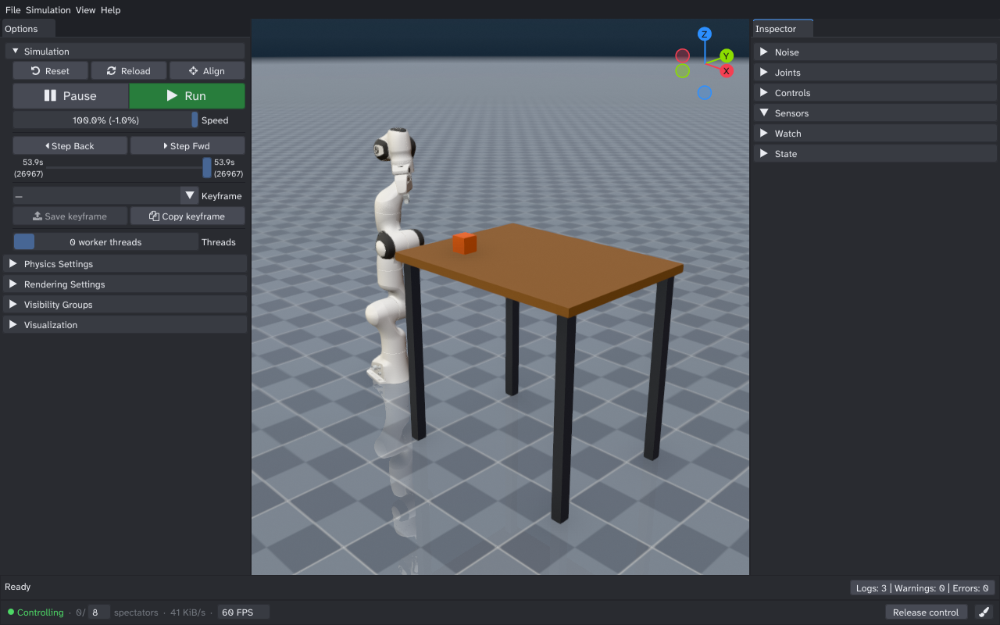
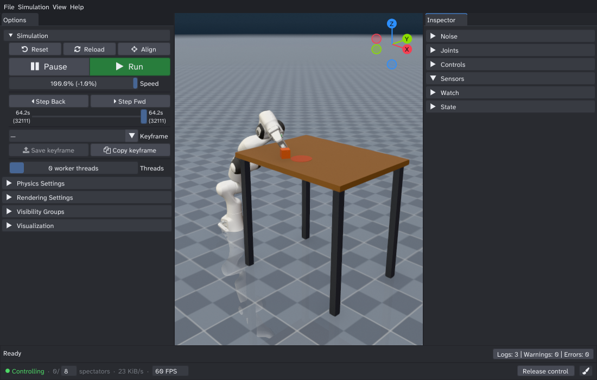

# mujoco-studio-lab

MuJoCo 4.0 Studio 的第一个 demo：用 `--gfx=web` 把无显示器容器的仿真串流到浏览器，验证视角拖动与 MJCF 热重载。

## Demo 预览

> GIF 占位（下面换成 `assets/demo.gif` 的真实预览）
>
> 
>
> 完整 10 秒视频：[assets/demo.mp4](assets/demo.mp4)

画面里：拖动鼠标左键改变相机视角；修改 `model.xml` 中球体的 `rgba` 蓝分量后，
浏览器自动热重载，小球由绿变蓝——全程无需重启仿真。

## 目录

```
mujoco-studio-lab/
├── docs/env.md          # 环境说明与完整复现步骤（容器 / conda / SSH 隧道）
├── model.xml            # 热重载验证用的最小 MJCF（绿色小球 + 位置伺服）
├── simulate.py          # SimPlugin：PreStepEvent 写正弦目标，驱动小球上下运动
├── scripts/             # 启动脚本 + record_demo.py（录屏复现脚本）
├── plugins/             # MuJoCo Studio 插件占位
├── models/              # MJCF 模型占位
├── demos/               # 4.0 新特性演示占位
└── assets/              # 录屏产物
    ├── demo.mp4         # 10 秒演示视频（H.264, 960x600）
    ├── demo.gif         # 同内容的 GIF 预览
    ├── shot_before.png  # 热重载前（绿色球）
    └── shot_after.png   # 热重载后（蓝色球）
```

## 怎么跑

环境搭建（conda `mujoco`，Python 3.12 + MuJoCo 4.0.1）见 [docs/env.md](docs/env.md)。
容器内启动 WebViewer：

```bash
source /opt/miniconda3/etc/profile.d/conda.sh && conda activate mujoco
export MUJOCO_GL=egl LIBGL_ALWAYS_SOFTWARE=1 EGL_PLATFORM=surfaceless
mujoco-studio --model=model.xml --plugins=simulate.py \
    --gfx=web --port=8081 --hot_reload=all
```

浏览器打开提示的地址（`http://localhost:8081`，容器端口需 SSH 隧道转发，见 env.md），
然后拖动视角、把 `model.xml` 里 sphere 的 `rgba` 蓝分量 `0.3` 改成 `1.0` 保存，观察小球变蓝。

重录这段 demo（容器内，需 playwright + chromium + ffmpeg）：

```bash
python scripts/record_demo.py
```

## 这段录屏说明了什么

- **Filament**：MuJoCo Studio 的 PBR 渲染后端，负责小球材质、棋盘地面、阴影与光照。
- **Dear ImGui**：左侧 Simulation / 右侧 Inspector 等界面组件，可 dock、可实时调参。
- **`--gfx=web`**：物理与 UI 分离在两端，通过非阻塞消息通道同步。无 GPU / 无显示器的机器跑物理，浏览器只负责串流显示；一个浏览器是 controller（可驱动仿真），其余为 spectator。这也是这段 10 秒录屏想展示的核心能力。


---

## Demo 2：场景骨架（Franka Panda + 桌面）

导入官方 [MuJoCo Menagerie](https://github.com/google-deepmind/mujoco_menagerie) 的
`franka_emika_panda`，搭好桌面 + 地面基础场景，验证可视化正常。详见 [docs/scene.md](docs/scene.md)。



要点：
- 模型放在 `assets/franka/`，主场景 `assets/scenes/push_cube.xml` 通过 `<include>` 引入；
- 地面 + 0.8×0.6 m 桌面（顶面 0.75 m）+ 灯光 + 双相机（`top_cam` 俯视观测 / `global_cam` 全局）；
- `hover` 关键帧：末端夹爪尖悬停在桌面上方 0.105 m，数值 IK 求得，无穿模（`pens=0`）；
- 已用 `mujoco-studio --gfx=web` 验证：拖动视角、暂停/播放无报错（Errors: 0）。

启动（端口 8082）：

```bash
source /opt/miniconda3/etc/profile.d/conda.sh && conda activate mujoco
export MUJOCO_GL=egl LIBGL_ALWAYS_SOFTWARE=1 EGL_PLATFORM=surfaceless
mujoco-studio --model=assets/scenes/push_cube.xml --gfx=web --port=8082 --hot_reload=all
# 或 ./scripts/start_webviewer.sh   (默认即场景骨架)
```

目录更新：

```
├── docs/scene.md        # 场景骨架说明（模型来源/构成/验证）
├── assets/franka/       # 官方 Panda 模型 + 67 个 mesh
├── assets/scenes/push_cube.xml  # 基础场景骨架
└── assets/{scene_default,scene_dragged,top_cam,global_cam}.png  # 可视化验证截图
```


---

## Demo 3：交互物体 + mocap 驱动（推物任务）

在场景骨架上加入可操作物体与目标区域，机械臂末端改由 **mocap 体 + 焊接约束**
驱动——不写任何底层控制，只给末端目标位置，IK 由 MuJoCo 约束求解器内部完成。
详见 [docs/task.md](docs/task.md)。

要点：
- **交互物体**：0.05 m / 0.1 kg 立方体（`freejoint`）+ 前方 0.2 m 半透明红色
  目标圆盘（不参与碰撞）；
- **驱动**：mocap 体 weld 到 `hand`，移动 `mocap_pos` 即可控制末端；动作空间
  预留 4 维 `[dx, dy, dz, gripper]`；
- **自动推物 plugin**（`push_sim.py`）：闭环轨迹演示，立方体滑向目标盘后复位循环；
- **观测相机**：`top_cam` 固定视角完整覆盖末端+立方体+目标区，输出 **224×224**；
- 验证：无头仿真立方体被推到 x=0.83（目标盘 0.82）；WebViewer 实测 Errors: 0。

启动（端口 8083）：

```bash
./scripts/start_push.sh
```



目录更新：

```
├── docs/task.md                 # 交互物体与 mocap 驱动说明
├── push_sim.py                  # 自动推物 plugin（含 4 维动作接口）
├── scripts/start_push.sh        # 一键启动推物 demo
├── assets/franka/panda_mocap.xml  # 无 actuator 的 Panda 副本（mocap 专用）
├── assets/scenes/push_cube.xml  # 完整任务场景
└── assets/{top_cam,global_cam,*_push}_224.png + push_webviewer.png  # 验证图
```
