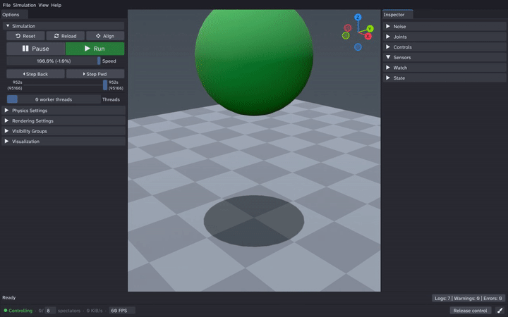

# mujoco-studio-lab

MuJoCo 4.0 Studio 的第一个 demo：用 `--gfx=web` 把无显示器容器的仿真串流到浏览器，验证视角拖动与 MJCF 热重载。

## Demo 预览

> GIF 占位（下面换成 `assets/demo.gif` 的真实预览）
>
> 
>
> 完整 10 秒视频：[assets/demo.mp4](assets/demo.mp4)

画面里：拖动鼠标左键改变相机视角；修改 `model.xml` 中球体的 `rgba` 蓝分量后，
浏览器自动热重载，小球由绿变蓝——全程无需重启仿真。

## 目录

```
mujoco-studio-lab/
├── docs/env.md          # 环境说明与完整复现步骤（容器 / conda / SSH 隧道）
├── model.xml            # 热重载验证用的最小 MJCF（绿色小球 + 位置伺服）
├── simulate.py          # SimPlugin：PreStepEvent 写正弦目标，驱动小球上下运动
├── scripts/             # 启动脚本 + record_demo.py（录屏复现脚本）
├── plugins/             # MuJoCo Studio 插件占位
├── models/              # MJCF 模型占位
├── demos/               # 4.0 新特性演示占位
└── assets/              # 录屏产物
    ├── demo.mp4         # 10 秒演示视频（H.264, 960x600）
    ├── demo.gif         # 同内容的 GIF 预览
    ├── shot_before.png  # 热重载前（绿色球）
    └── shot_after.png   # 热重载后（蓝色球）
```

## 怎么跑

环境搭建（conda `mujoco`，Python 3.12 + MuJoCo 4.0.1）见 [docs/env.md](docs/env.md)。
容器内启动 WebViewer：

```bash
source /opt/miniconda3/etc/profile.d/conda.sh && conda activate mujoco
export MUJOCO_GL=egl LIBGL_ALWAYS_SOFTWARE=1 EGL_PLATFORM=surfaceless
mujoco-studio --model=model.xml --plugins=simulate.py \
    --gfx=web --port=8081 --hot_reload=all
```

浏览器打开提示的地址（`http://localhost:8081`，容器端口需 SSH 隧道转发，见 env.md），
然后拖动视角、把 `model.xml` 里 sphere 的 `rgba` 蓝分量 `0.3` 改成 `1.0` 保存，观察小球变蓝。

重录这段 demo（容器内，需 playwright + chromium + ffmpeg）：

```bash
python scripts/record_demo.py
```

## 这段录屏说明了什么

- **Filament**：MuJoCo Studio 的 PBR 渲染后端，负责小球材质、棋盘地面、阴影与光照。
- **Dear ImGui**：左侧 Simulation / 右侧 Inspector 等界面组件，可 dock、可实时调参。
- **`--gfx=web`**：物理与 UI 分离在两端，通过非阻塞消息通道同步。无 GPU / 无显示器的机器跑物理，浏览器只负责串流显示；一个浏览器是 controller（可驱动仿真），其余为 spectator。这也是这段 10 秒录屏想展示的核心能力。
