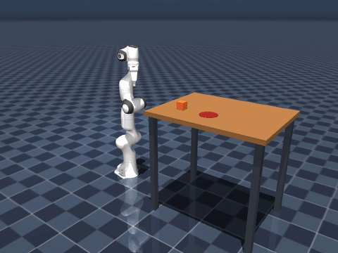
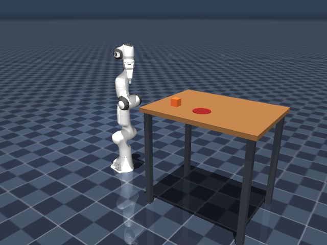
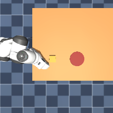

# mujoco-studio-lab

**第一周里程碑（v0.1.0-scene-ready）：Franka Panda 推方块任务的纯仿真验证环境 + LeRobot 格式专家演示数据。**

> ⚠️ 定位：**纯算法验证仿真环境，不涉及底层控制**。机械臂由 MuJoCo 的 mocap + weld 约束驱动（内部求解 IK 与位置控制），我们只给末端目标位置；没有自写逆运动学、没有关节力矩控制、不调物理参数（摩擦/质量/阻尼均为默认量级）。第二周将在此环境上对接 LeRobot 做模仿学习训练。

---

## 演示预览

10 秒专家轨迹：机械臂从初始位置出发，接近立方体 → 下压接触 → 推动到红色目标圆盘（离屏渲染录制，无需 WebViewer）。



[完整 10 秒视频（MP4）](assets/expert_push_demo.mp4) · 640×480 / 24 fps

| 场景全景 (`global_cam`) | 相机观测视角 (`top_cam` 224×224) | 目标到达特写 |
| :---: | :---: | :---: |
|  |  |  |

---

## 1. 项目简介

本仓库是「具身智能算法验证」系列的第一站：用 MuJoCo 4.0 搭建一个 **Franka Panda 推方块（push-cube）** 仿真任务，并提供标准化 Gymnasium 接口、稠密+稀疏奖励、脚本化专家演示，以及可直接喂给 LeRobot 的演示数据集。

- **任务**：把边长 0.05 m 的橙色立方体，从桌面 `(0.62, -0.12)` 推到前方 0.2 m 处的半透明红色目标圆盘（中心 `(0.82, -0.12)`，半径 0.03 m 判定成功）。
- **控制抽象**：末端由一个 mocap 体通过 weld 约束"焊接"到 Panda 的手，只需移动 mocap 目标点，MuJoCo 约束求解器自动完成 IK 与跟随——**我们不写控制器**。
- **下游用途**：产出的 LeRobot v3 数据集是第二周模仿学习（BC / diffusion policy）训练的输入。

仓库还保留了第一天的 WebViewer 串流 demo（见 [docs/env.md](docs/env.md)），以及从场景骨架到数据集的完整开发记录（[docs/](docs/)）。

---

## 2. 环境依赖

开发和验收全部在一台 Docker 容器 `wzh-ai` 内完成（Ubuntu 22.04 + NVIDIA RTX A6000，CUDA 驱动 550）。**已存在 `mujoco` conda 环境**（Python 3.12），本项目只需要在此基础上补装下列包：

| 包 | 版本（验收值） | 用途 |
| --- | --- | --- |
| `mujoco` | 4.0.1 | 物理仿真 + 离屏渲染（`mujoco.Renderer`） |
| `gymnasium` | 1.4.0 | 标准化 Env / spaces 接口 |
| `numpy` | 2.5.5 | 数组与轨迹计算 |
| `pillow` | 13.0.0 | 图像处理 |
| `opencv-python-headless` | 5.0.0 | 图像/视频工具（无 GUI 依赖） |
| `pyarrow` | 26.0.1 | LeRobot parquet 读写 |
| `h5py` | 3.16.0 | HDF5 工具 |
| `ffmpeg`（系统） | 4.4.2 | 演示视频/GIF 编码 |

> **可视化用 `mujoco` 环境，LeRobot 数据处理用 `lerobot` 环境**（两者分开）。LeRobot 环境为 0.7.0，另需 `av==15.1.0`（av 19 与 lerobot 0.7 不兼容）。

一次性搭建（容器内）：

```bash
source /opt/miniconda3/etc/profile.d/conda.sh
conda create -n mujoco python=3.12 -y && conda activate mujoco
pip install mujoco gymnasium pillow opencv-python-headless pyarrow h5py
python -c "import mujoco; print(mujoco.__version__)"   # 4.0.1
```

无头渲染必须设置环境变量（后续每条命令都要）：

```bash
export MUJOCO_GL=egl LIBGL_ALWAYS_SOFTWARE=1 EGL_PLATFORM=surfaceless
```

---

## 3. 快速上手

以下命令均在**容器内的仓库根目录**执行，且已激活 `mujoco` 环境并设置好上面的 EGL 变量。

### 步骤 1：场景可视化（WebViewer）

```bash
./scripts/start_push.sh          # 加载 assets/scenes/push_cube.xml，端口 8083
```

浏览器打开提示的地址（容器内端口需 SSH 隧道转发到 localhost，见 [docs/env.md](docs/env.md)），即可看到 Panda + 桌面 + 立方体 + 红色目标盘，并观察自动推物动画循环。

或做无浏览器的离屏渲染自检（不需要 WebViewer）：

```bash
python envs/test_env.py          # 50 步随机交互，打印观测形状与奖励
```

### 步骤 2：随机交互（Gymnasium 环境）

```bash
python - <<'PY'
from envs.push_cube_env import PushCubeEnv
env = PushCubeEnv()
obs, info = env.reset(seed=0)
print('image', obs['image'].shape, 'state', obs['state'].shape)
ret = 0
for _ in range(50):
    obs, r, term, trunc, info = env.step(env.action_space.sample())
    ret += r
    if term or trunc:
        break
print('return', round(ret, 3), 'steps', info['steps'])
env.close()
PY
```

预期：`image=(224,224,3) uint8`、`state=(13,) float32`，50 步内无报错。

### 步骤 3：数据采集（生成专家演示 → 导出 LeRobot）

```bash
# mujoco 环境：脚本化专家推物，渲染 224×224 观测，产出 data/raw_demos.npz
python scripts/collect_demos.py gen --episodes 10 --select 5

# 切到 lerobot 环境：导出为 LeRobot v3 数据集
conda activate lerobot
python scripts/collect_demos.py export --raw data/raw_demos.npz --out data/push_cube_demos
python scripts/collect_demos.py verify --root data/push_cube_demos   # 打印 VERIFY OK
```

预期：5 episodes / 183 frames / fps=50，末尾打印 `VERIFY OK`。

一键全链路压测（mujoco 环境）：

```bash
python scripts/stress_test.py     # 输出 JSON，末尾 PASS=true 即通过
```

> 压测自包含：克隆后可直接运行。若本地没有 `data/raw_demos.npz`（已被 gitignore），脚本会自动生成一小批专家数据用于时序对齐校验；A 段（无崩溃/NaN/黑帧）与 C 段（重置稳定性）为硬性指标。

重录本页顶部的 10 秒演示视频与截图：

```bash
python scripts/record_expert_video.py
```

---

## 4. 接口说明

### 4.1 观测空间 `observation_space`（`spaces.Dict`）

| 键 | 类型 / 形状 | 说明 |
| --- | --- | --- |
| `image` | `Box(0,255,(224,224,3),uint8)` | 固定相机 `top_cam` 的 RGB 观测（正下方俯视，fovy=50°，完整覆盖末端+立方体+目标），核心视觉输入 |
| `state` | `Box(13,),float32` | `[7 个臂关节角] + [cube_x,cube_y,cube_z] + [target_x,target_y,target_z]` |

### 4.2 动作空间 `action_space`（`Box(4,),float32`）

```
a = [dx, dy, dz, gripper]
```

- `a[:3]`：末端 **xyz 平移增量**，每轴限幅 `±0.02 m`；`step()` 内把它加到 mocap 目标位置，并 clip 到可达工作空间盒 `x∈[0.10,0.85], y∈[-0.25,0.25], z∈[0.82,1.15]`。
- `a[3]`：夹爪开合 `0..1`，**接口预留**（推物任务保持闭合，暂不驱动）。
- 全程 **不触碰关节力矩**，IK 由 weld 约束内部完成。

### 4.3 奖励函数（稠密引导 + 稀疏最终）

`reward = r_shaping + r_ee + r_time + r_sparse + r_fail`

| 分量 | 公式 | 系数 |
| --- | --- | --- |
| 稠密·距离整形 | `-K_DIST · (dist_t − dist_{t−1})`（势能差分，靠近为正） | `K_DIST=10` |
| 稠密·末端引导 | `-K_EE · ‖ee − cube‖`（弱引导，防本末倒置） | `K_EE=0.1` |
| 时间惩罚 | `-0.01` / 步 | `TIME_PENALTY=0.01` |
| 稀疏·成功 | 立方体中心距目标 `< 0.03 m` → `+10`，回合终止 | `SUCCESS_BONUS=10` |
| 失败惩罚 | 立方体掉出桌面 → `-1`，回合终止 | `FAIL_PENALTY=-1` |

- `dist`：立方体中心到目标的 **xy 平面距离**。
- `terminated`：成功（dist<0.03）或失败（立方体 z 低于桌面顶 0.03 m，或 xy 越出桌面范围）。
- `truncated`：`max_episode_steps=50`（frame_skip=10，物理步长 2 ms → 每步 20 ms）且未触发 terminated。

奖励函数写成当前状态与 `_prev_dist` 的纯函数，`envs/test_reward.py`（16 项断言）可直接注入关键状态单测。

---

## 5. 数据集格式

演示数据以 **LeRobot v3** 格式存放于 `data/push_cube_demos/`（5 episodes / 183 frames / fps=50）：

```
data/push_cube_demos/
├── data/chunk-000/file-000.parquet       # 逐帧: state / action / timestamp / *_index
├── videos/observation.images.main/
│   └── chunk-000/file-000.mp4            # 224×224 AV1 视频（每帧图像）
└── meta/
    ├── info.json                         # 元信息 / features / 8:2 切分
    ├── features.json                     # 观测/动作空间的独立可读定义
    ├── stats.json                        # 各字段 mean/std/min/max（训练归一化）
    ├── tasks.parquet                     # 任务描述表
    └── episodes/chunk-000/file-000.parquet
```

字段（`meta/info.json` 的 `features`）：

| 字段 | dtype / shape | 说明 |
| --- | --- | --- |
| `observation.images.main` | video `(224,224,3)` | `top_cam` 视觉观测，存为 AV1 视频 |
| `observation.state` | float32 `(13,)` | 7 关节角 + 立方体 xyz + 目标 xyz |
| `action` | float32 `(4,)` | `[dx,dy,dz,gripper]` |
| `timestamp` | float32 `(1,)` | 回合内相对时间（0, 0.02, 0.04 …） |
| `frame_index` / `episode_index` / `index` / `task_index` | int64 `(1,)` | 帧/回合/全局/任务索引 |

读取（lerobot 环境）：

```python
from lerobot.datasets.lerobot_dataset import LeRobotDataset
ds = LeRobotDataset('push_cube_expert', root='data/push_cube_demos', video_backend='pyav')
print(ds.num_episodes, ds.num_frames, ds.fps)   # 5 183 50
sample = ds[0]                                  # image (3,224,224) / action (4,) / state (13,)
```

**8:2 训练/验证切分**（LeRobot 原生 `splits`，基于 episode 连续编号）：`info.json` 的
`splits = {"train": "0:4", "val": "4:5"}` → train 4 episodes / 146 帧（79.8%），
val 1 episode / 37 帧（20.2%），分布一致。用原生 `episodes` 参数加载子集：

```python
tr = LeRobotDataset('push_cube_expert', root='data/push_cube_demos', video_backend='pyav', episodes=[0,1,2,3])
va = LeRobotDataset('push_cube_expert', root='data/push_cube_demos', video_backend='pyav', episodes=[4])
```

一键验证原生加载（打印长度/episode 数、batch shape/dtype、随机帧时空对齐图、动作归一化）：

```bash
python scripts/prepare_dataset.py    # 生成 features.json、重算 stats.json、设置 8:2 splits
python scripts/verify_dataset.py     # 打印 VERIFY DATASET OK，产出 assets/dataset_sample.png
```

> 原始中间产物 `data/raw_demos.npz` 已被 `.gitignore` 忽略，不入库；入库的是标准化的 `data/push_cube_demos/`。

---

## 6. 自定义环境接入 LeRobot（训练中自动评估）

把第一周的 `PushCubeEnv` 封装为 LeRobot 兼容环境，可被原生加载用于 rollout / 训练中评估。

> **版本说明**：本项目 LeRobot 为 v0.7.0（2026 定制版）。该版本**没有 `BaseEnv` 基类**，环境本体是标准 `gymnasium.Env`；「注册表」实际是 `EnvConfig.register_subclass` + `gym.register`。实现按真实 API 落地。

**封装内容**（`envs/lerobot_push_cube_env.py`）：
- `PushCubeEnvWrapper`（继承 `gym.Env`）实现四方法：`reset()` / `step(action)` / `render()` / `close()`。
- **观测键与数据集 100% 对齐**：`observation.images.main`（uint8 224×224×3）、`observation.state`（float32 13）；由 `canonical_observation` 把底层的 `pixels` / `agent_pos` 映射而来。
- **动作反归一化**：`step` 接收归一化 4 维动作，按 `data/push_cube_demos/meta/stats.json` 的 mean/std 还原为原始动作后再驱动 mocap+weld；gripper 常量维已防除零。
- **注册**：gym id `gym_push_cube/PushCube-v0`（直用）+ `gym_push_cube_raw/PushCube-v0`（供 LeRobot gym 集成）；`PushCubeEnvConfig` 以 `push_cube` 注册进 `EnvConfig`，可用 `--env.type=push_cube` 选择。

**前置**：`lerobot` 环境需补装 mujoco（环境底层依赖）：`pip install mujoco==4.0.1`。

**单步验证**（lerobot 环境，随机 10 步 + 原生 `make_env`）：
```bash
conda activate lerobot
export MUJOCO_GL=egl LIBGL_ALWAYS_SOFTWARE=1 EGL_PLATFORM=surfaceless
python scripts/test_lerobot_push_cube.py    # 打印 TEST LEROBOT PUSH CUBE: PASS
```

**完整回合 rollout**（官方 `lerobot.scripts.lerobot_eval.rollout` + 随机策略，产出评估视频）：
```bash
python scripts/rollout_lerobot_push_cube.py
# -> assets/eval_random_rollout.mp4（评估视频）
# -> data/eval_rollout_metrics.json（steps / reward / success）
```

验证结果：descriptor 正确暴露 `observation.images.main` / `observation.state` 与 4 维动作；rollout 完整跑满 50 步、渲染 51 帧，链路正常。随机策略成功率低属预期（仅验证评估链路，非策略性能）。

### 6.1 ACT 冒烟训练入口

本仓库提供 wrapper + 配置，可直接用 LeRobot 的 ACT 策略对本数据集做训练（**在 `lerobot` 环境**，需先装 `accelerate`）：

```bash
python scripts/train_act_push_cube.py --config_path=configs/act_push_cube.yaml
# 100 步 / batch 8 / CPU；step 50、100 触发闭环评估并生成视频
# 一键脚本与踩坑记录见兄弟仓库 embodied-policy-zoo（scripts/train_act_push_cube.sh / docs/ACT_TRAINING_NOTES.md）
```

wrapper 会先 import `envs/lerobot_push_cube_env` 完成 `push_cube` 注册，再进入官方训练入口；
`output_dir` 须不存在。冒烟实测 loss `1.78→0.53`（4.37 epoch），checkpoint 与评估视频正常产出。

---

## 7. 后续规划（第二周）

- ~~对接 LeRobot 做模仿学习训练~~：ACT 冒烟训练已跑通（见 6.1）；后续扩量训练 BC / Diffusion Policy，输入 `(image, state)`、输出 4 维动作。
- **闭环评测**：把训练策略接回 `PushCubeEnv`，用成功率 / 平均步数 / 回报评估，与专家基线对比。
- **数据扩展**：增加立方体初始位姿随机性与多目标点，提升策略泛化；按需引入更丰富的相机视角。
- **真实迁移预留**：接口与 LeRobot 对齐，后续可替换为真实机器人遥操作数据。

---

## 目录结构

```
mujoco-studio-lab/
├── assets/
│   ├── franka/                  # 官方 Panda 模型 + panda_mocap.xml（无 actuator）
│   ├── scenes/push_cube.xml     # 任务场景（mocap+weld + 立方体 + 目标 + 双相机）
│   ├── expert_push_demo.mp4/.gif# 10 秒专家演示（本页顶部）
│   ├── scene_overview.png       # 场景全景截图
│   ├── camera_observation.png   # 相机观测视角截图
│   ├── goal_reached.png         # 目标到达特写截图
│   ├── eval_random_rollout.mp4  # LeRobot 随机策略评估视频
│   └── *.png / demo.*           # 其余验证图与 WebViewer 热重载录屏
├── envs/
│   ├── push_cube_env.py         # Gymnasium 环境（观测/动作/奖励/终止/步进）
│   ├── lerobot_push_cube_env.py # LeRobot 兼容封装 + 注册 + 反归一化
│   ├── test_env.py / test_reward.py
├── scripts/
│   ├── collect_demos.py         # 专家演示生成 + LeRobot 导出 + 验证（三段式）
│   ├── stress_test.py           # 全链路压测
│   ├── record_expert_video.py   # 离屏录制演示视频 + 关键截图
│   ├── test_lerobot_push_cube.py      # 环境单步验证 + 原生 make_env
│   ├── rollout_lerobot_push_cube.py   # 官方 rollout + 评估视频
│   ├── record_demo.py           # WebViewer 热重载录屏复现
│   └── start_*.sh               # 一键启动脚本
├── utils/
│   ├── vision.py                # 离屏渲染 / PNG 导出 / 黑帧检测 / 帧差
│   └── validation.py            # 接触穿透检查 / 数据对齐 / 重置稳定性
├── data/
│   ├── push_cube_demos/         # LeRobot v3 数据集（入库）
│   └── eval_rollout_metrics.json      # rollout 评估指标
├── docs/                        # env / scene / task / integration 说明
├── push_sim.py / model.xml / simulate.py   # WebViewer 串流 + 热重载 demo
└── README.md
```

## 开发记录

- [docs/env.md](docs/env.md) — 环境搭建、WebViewer 串流与热重载验证
- [docs/scene.md](docs/scene.md) — 场景骨架（Panda + 桌面 + 双相机）
- [docs/task.md](docs/task.md) — 交互物体、mocap 驱动、观测相机校准、Gym 接口、奖励
- [docs/integration.md](docs/integration.md) — 全链路压测、Bug 修复、穿模调查与结论

**版本**：`v0.1.0-scene-ready`（第一周里程碑）。
