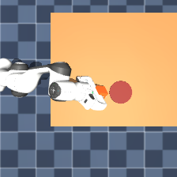
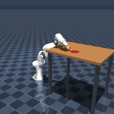
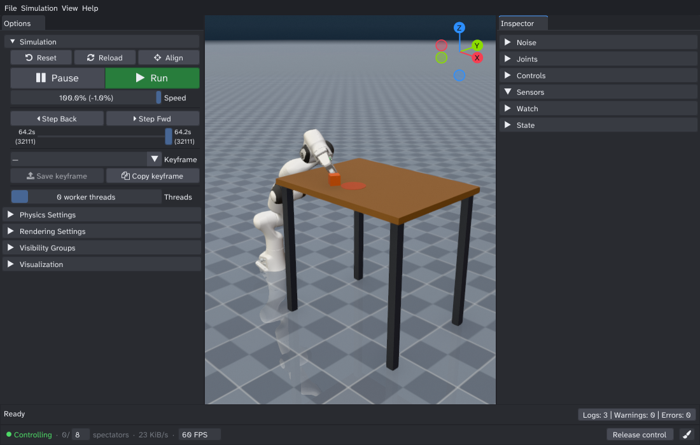

# 交互物体与 mocap 驱动：立方体、目标区与碰撞调试

仓库的第三个 demo：**添加操作物体与目标区域，用 mocap + 焊接约束驱动机械臂末端，
调通基础物理交互，并校准 224×224 观测相机**。
场景骨架（Demo 2）见 [docs/scene.md](scene.md)。

## 交互物体（`assets/scenes/push_cube.xml`）

| 元素 | 配置 |
| --- | --- |
| 操作立方体 `cube` | 边长 **0.05 m**，质量 **0.1 kg**（density=800），`<freejoint>` 可自由移动；摩擦 `1.0 0.1 0.01`（默认量级，未精细调校），初始在桌面 `(0.62, -0.12)` |
| 目标区 `target` | 立方体前方 **0.2 m**（+x）的半透明红色圆盘（`cylinder r=0.06`，rgba alpha=0.35）；`contype=0 conaffinity=0`，**纯视觉标记，不参与碰撞** |
| 桌面 | 摩擦系数与立方体一致（默认量级）；立方体-桌面接触取几何平均 |

## 驱动方式：mocap 体 + 焊接约束（全程无底层控制）

场景里没有任何手写的关节控制。机械臂末端由一个 **mocap 体** 驱动：

```xml
<body name="mocap" mocap="true" pos="0.088 0 0.926" quat="0 0.92388 0.382683 0">
  <geom type="sphere" size="0.012" rgba="0.1 0.9 0.3 0.85" contype="0" conaffinity="0"/>
</body>

<equality>
  <weld name="ee_weld" body1="mocap" body2="hand" solref="0.01 1" solimp="0.9 0.95 0.001"/>
</equality>
```

- mocap 初始位姿 = `home`（关节全零）时 `hand` 的世界位姿，焊接零初始误差；
- **只需给 `mocap_pos` 目标位置**，逆运动学与位置控制由 MuJoCo 约束求解器内部完成；
- 绿色小球即 mocap 目标点，WebViewer 里可见。

### 踩坑记录（为什么用 `panda_mocap.xml`）

1. **actuator 与 weld 对抗**：官方 `panda.xml` 自带 7 个关节位置 actuator
   （PD 增益 4500，ctrl 默认 0 = home 姿态）。任何非零关节角下仿真一开步，
   actuator 就把机械臂拽回 home，weld 完全拉不动（末端稳态误差 0.5 m）。
   解决：生成 `assets/franka/panda_mocap.xml`（官方文件的副本，仅移除
   `<actuator>` 段与 keyframe 的 `ctrl` 属性），场景 include 它；
   官方 `panda.xml` 保持原样不受影响。
2. **必须从 home 姿态起步**：从弯曲的 hover 关键帧起步时 weld + 冗余自由度
   求解不稳定（QACC NaN）。`push_home` 关键帧把 7 个臂关节置零 + 立方体
   freejoint 初始位姿（16 维 qpos），weld 从零误差启动后全程稳定。

### 动作空间（4 维，预留接口）

```
a = [dx, dy, dz, gripper]
```

- `a[:3]`：末端 xyz 平移增量（`data.mocap_pos[0] += a[:3]`）；
- `a[3]`：夹爪开合 0–255，推物任务保持闭合（0），接口已预留
  （见 `push_sim.py` 的 `apply_action`）。

## 自动推物演示（`push_sim.py`）

MuJoCo Studio 插件在 `PreStepEvent` 里沿闭环轨迹驱动 mocap（smoothstep 插值）：

```
home → 立方体上方 → 下压接触 → 慢速前推 0.18m（滑向红色目标盘）→ 抬起 → 回 home
```

每个循环开始时把立方体复位到初始位姿。无头仿真验证：立方体被推到
x=0.83（目标盘中心 x=0.82，正中目标）。启动：

```bash
./scripts/start_push.sh        # 场景 + plugin，端口 8083
```

## 观测相机校准

- `top_cam`：固定在 `(0.65, -0.10, 1.75)` 正下方俯视，fovy=50°，画面完整覆盖
  「机械臂末端 + 立方体 + 目标区」（推动全程三者始终在画面内）；
- **输出分辨率固定 224×224**（视觉算法通用尺寸），离屏渲染脚本
  `mujoco.Renderer(m, height=224, width=224)`；
- `global_cam`：全局斜侧视角，用于人工检查与调试。

| `top_cam` 224×224（推动中） | `global_cam` 224×224（推动中） |
| --- | --- |
|  |  |

## 验证结果

- 立方体 0.1 kg 精确（`body_mass` 校验）；mocap 移动 → 末端跟随（小范围内
  稳态误差 ≤ 0.02 m），接触立方体后可推动；
- WebViewer（8083 端口）实测推物动画循环运行，浏览器 **Errors: 0、60 FPS**：



*浏览器实测：夹爪正把橙色立方体推向红色目标盘。*

## 当日产出

- `assets/scenes/push_cube.xml`：完整任务场景（立方体 + 目标区 + mocap + weld + 相机）
- `assets/franka/panda_mocap.xml`：无 actuator 的 Panda 副本（mocap 驱动专用）
- `push_sim.py`：自动推物 plugin + 4 维动作接口预留
- `scripts/start_push.sh`：一键启动（端口 8083）
- `assets/{top_cam,global_cam,top_cam_push,global_cam_push}_224.png`：224×224 相机标定图
- `assets/push_webviewer.png`：浏览器推物动画截图


## 环境接口封装（`envs/push_cube_env.py`）

基于 Gymnasium 基类的标准化环境，把场景封装成 `reset / step / 观测 / 动作` 四要素：

| 要素 | 定义 |
| --- | --- |
| 观测 `spaces.Dict` | `image`: Box(224,224,3) uint8，`top_cam` RGB（核心观测）；`state`: Box(13,) float32 = 7 关节角 + 立方体位置(3) + 目标位置(3) |
| 动作 `Box(4,)` | `[dx,dy,dz,gripper]` 每步增量，平移每步限幅 **±0.02 m**；内部把增量加到 **mocap 目标位置**（并钳位到可达工作空间盒），不碰关节力矩；gripper 0–1 为预留接口 |
| 奖励 | 稠密 `-‖cube_xy - target_xy‖` + 推到目标盘内（半径 0.06 m）一次性 **+5** |
| 终止/截断 | `terminated`: 立方体到达目标盘；`truncated`: 默认 100 步（frame_skip=10 → 每步 20 ms） |

用法：

```python
from envs.push_cube_env import PushCubeEnv
env = PushCubeEnv()
obs, info = env.reset(seed=0)
obs, r, term, trunc, info = env.step(env.action_space.sample())  # 随机交互
```

验证（`envs/test_env.py`）：50 步随机动作无报错，`image` (224,224,3) uint8、
`state` (13,) float32；脚本化推动序列下奖励随立方体靠近目标而增大
（dist 0.216 → 0.112，reward -0.216 → -0.112）。
